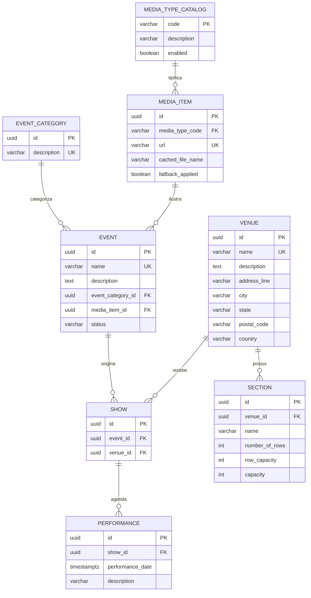
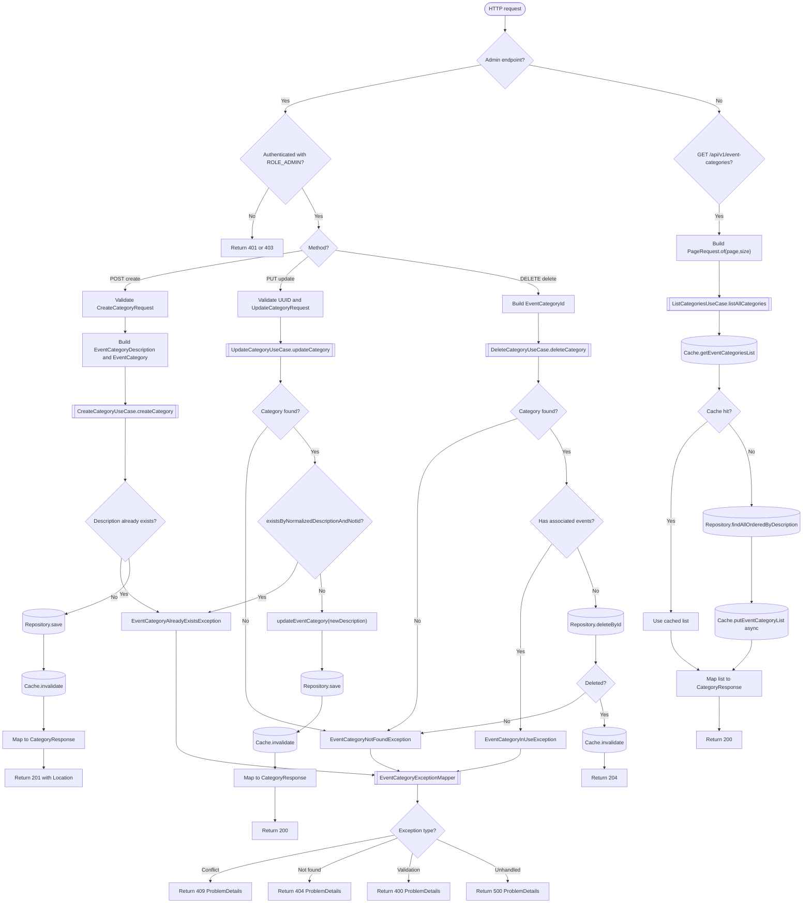

# `microservice-catalog`

> **Fonte única de verdade** da especificação do catálogo. Qualquer alteração de RN/US/CA é feita aqui; as specs `specs/NNN-*/` detalham cada US e devem apontar para este arquivo.

**Legenda:** `[NOVO]` = sem equivalente no legado (backlog de funcionalidade nova) · `[ALTERA RNxx]` = modifica regra as-is, que permanece documentada para rastreio · `[LACUNA Lxx]` = ponto não coberto pelos documentos (seção 11) · `[PROPOSTO]` = derivado da arquitetura/constitution, a confirmar.

---

## 1. Escopo e responsabilidade

Gerenciamento das entidades de divulgação artística, locais físicos, shows cadastrados e a agenda temporal de apresentações (performances). Serviço *read-heavy*: dados expostos ao canal público de vendas e ao painel administrativo.

| Item | Definição |
|---|---|
| Banco | PostgreSQL `catalog_db`, schema `catalog`, otimizado para leitura (ADR 03) |
| Cache | Redis, Cache-Aside para listagens públicas de eventos e estrutura de venues |
| APIs | REST: consulta pública + CRUD administrativo |
| Dependências | Nenhuma (serviço raiz) |
| Consumidores | `inventory` (snapshots de seção/performance), `booking`, `telemetry` |
| Agregados | **Event** (raiz; VO `EventCategory`, `MediaItem`) · **Venue** (raiz; entidade `Section`; VO `Address`) · **Show** (raiz; entidade `Performance`) |
| Relação entre contextos | Catalog ↔ Scheduling: *Shared Kernel*; Scheduling → Inventory: *Customer-Supplier* |
| Runtime | Quarkus + Hibernate Reactive/Panache + Mutiny (ver L-09 sobre versão do Java) |

---

## 2. Regras de negócio

### 2.1 Regras as-is mantidas

| RN | Regra | Origem (legado) | Destino | US | Observações |
|---|---|---|---|---|---|
| RN01 | Nome do evento único em toda a base | `Event.java` `@Column(unique)` | Event | CAT-08 | `UNIQUE(name)` |
| RN02 | Nome do evento entre 5 e 50 caracteres | `Event.java` `@Size` | Event | CAT-08 | `CHECK` + validação no use case |
| RN03 | Descrição do evento entre 20 e 1000 caracteres | `Event.java` `@NotNull @Size` | Event | CAT-08 | idem |
| RN04 | Evento associado a uma categoria ativa (`EventCategory`) | `Event.java` `category @NotNull` | Event | CAT-08, 09 | FK `NOT NULL ... ON DELETE RESTRICT` |
| RN05 | Imagem promocional do evento é opcional | `Event.mediaItem` sem `@NotNull` | Event | CAT-08, 12 | `media_item_id` nullable |
| RN06 | Descrição da categoria única e não nula | `EventCategory.java` | Event (VO) | CAT-09 | Unicidade normalizada (`lower(btrim)`), migração V1.0.1 |
| RN07 | Nome do Venue único e não vazio | `Venue.java` | Venue | CAT-10 | `UNIQUE` + `CHECK btrim<>''` |
| RN08 | Show = associação única Event+Venue | `Show.java` `@UniqueConstraint` | Show | CAT-11 | `UNIQUE(event_id, venue_id)`; duplicidade → 409 |
| RN09 | Performance exige data/hora e Show válido | `Performance.java` `@NotNull` | Show | CAT-11 | `NOT NULL` |
| RN10 | Sem duas performances do mesmo show na mesma data/hora | `Performance.java` `@UniqueConstraint` | Show | CAT-11 | `UNIQUE(show_id, performance_date)`; 409 |
| RN11 | Nome da seção único dentro do Venue | `Section.java` `@UniqueConstraint` | Venue | CAT-10 | `UNIQUE(venue_id, name)` |
| RN12 | Capacidade da seção = fileiras × capacidade por fileira | `Section.getCapacity()` | Venue | CAT-10 | Coluna gerada (`GENERATED ALWAYS`); evita divergência em SQL/relatórios |
| RN34 | Tipo de mídia restrito a `IMAGE` | `MediaType.java` (enum) | Event (VO MediaItem) | CAT-12, 14 | **Alterada**, ver 2.2 |
| RN35 | Em falha de carga da imagem, usar `not_available.jpg` | `MediaManager.createPath` | MediaItem | CAT-12 | Ver L-02: "injetar síncronamente" conflita com o diagnóstico 3.4 e com CA-CAT-03 |
| RN37 | URL de mídia válida (`http/https`) e única | `MediaItem.java` `@URL` | MediaItem | CAT-12 | `UNIQUE(url)` + `CHECK` de esquema |

### 2.2 Alterações e regras novas decididas

| ID | Tipo | Descrição | US | Fonte |
|---|---|---|---|---|
| **[ALTERA RN34]** | Altera | O tipo de mídia deixa de ser enum fechado e passa a catálogo extensível (`IMAGE`, `VIDEO`, `AUDIO`), configurável sem redeploy | CAT-14 | spec do catálogo |
| **[NOVO] Ciclo de vida do Event** | Nova | `DRAFT → PUBLISHED → ARCHIVED` explícito. Hoje todo evento criado já aparece no catálogo público | CAT-13 | spec do catálogo |
| **[NOVO] Proteção de categoria** | Nova | `EventCategory` não pode ser excluída com `Event` associado (hoje só por erro de integridade do banco) | CAT-09 | spec do catálogo |
| **[ALTERA RN42]** | Altera | Paginação única `page`/`size`, base 0, em todas as APIs (legado: público base 1, admin base 0) | todas as listagens | arquitetura 25.3, constitution IV |
| **RN-NOVA-02** (aplicada ao catálogo) | Nova | Toda rota de escrita administrativa exige token com `ROLE_ADMIN` (painel legado era aberto) | CAT-08–14 | arquitetura 25.1 |

---

## 3. Histórias de usuário

| US | História | Origem legado | Papel | Spec |
|---|---|---|---|---|
| US-CAT-01 | Consultar catálogo de eventos ativos (`status = PUBLISHED`) | US01 | Público | `001` |
| US-CAT-02 | Filtrar eventos por categoria de interesse | US02 | Público | `002` |
| US-CAT-03 | Visualizar detalhes artísticos e imagem de um evento por ID | US03 | Público | `003` (umbrella) |
| US-CAT-04 | Consultar locais (Venues) disponíveis para venda | US04 | Público | `004` |
| US-CAT-05 | Detalhes de um local (capacidade total, seções, endereço) | US05 | Público | `005` |
| US-CAT-06 | Listar agenda de shows de um evento ou local | US06 | Público | `006` |
| US-CAT-07 | Consultar sessões (performances) ativas de um show | US07 | Público | `007` |
| US-CAT-08 | Gerenciar cadastro de eventos (CRUD) | US18 | Admin | `008` |
| US-CAT-09 | Gerenciar categorias de eventos | US19 | Admin | `009` |
| US-CAT-10 | Gerenciar locais físicos e suas seções | US20, US21 | Admin | `010` |
| US-CAT-11 | Criar e alterar shows e performances | US22, US23 | Admin | `011` |
| US-CAT-12 | Cadastrar itens de mídia com validação de URL | US26 (+US40, US41) | Admin | `012` |
| US-CAT-13 `[NOVO]` | Cadastrar evento em rascunho e publicar quando pronto | — | Admin | `013` |
| US-CAT-14 `[NOVO]` | Cadastrar mídia em vídeo sem alterar código | — | Admin | `014` |

---

## 4. Critérios de aceite

### 4.1 Definidos

* **CA-CAT-01-VAL:** toda alteração de evento valida as constraints (nome 5–50, descrição 20–1000) e retorna 400 (Problem Details) em falha.
* **CA-CAT-02-UNI:** a criação de Show ou Performance valida unicidades relacionais no banco e retorna **409** em duplicidade.
* **CA-CAT-03-MED:** falha na resolução HTTP da imagem do `MediaItem` na persistência administrativa **não trava o cadastro**: persiste a URL original e marca a imagem para fallback de leitura local (`fallback_applied`).

### 4.2 Complementares `[PROPOSTO]` (derivados da constitution e da arquitetura)

* **CA-CAT-04-SEC:** `POST/PUT/DELETE` sem token retornam 401; com token sem `ROLE_ADMIN`, 403; `GET` públicos funcionam sem token.
* **CA-CAT-05-PAG:** toda listagem aceita `page`/`size` (base 0) e responde de forma uniforme entre canais público e admin.
* **CA-CAT-06-CCH:** após escrita administrativa, o cache correspondente é invalidado e a leitura seguinte reflete o dado novo.
* **CA-CAT-07-PRF:** leituras públicas p95 ≤ 250 ms (constitution V), com carga e perfil definidos no plan de cada US.

---

## 5. Contratos transversais

### 5.1 API
* Base `/api/v1`. Erros em **RFC 7807** (Problem Details). Identificadores UUID. Datas ISO-8601 (UTC).
* Matriz de autorização (arquitetura 15.4):

| Endpoint | Método | Autorização |
|---|---|---|
| `/events`, `/venues`, `/shows`, `/performances` | GET | Público |
| `/event-categories` | GET | Público |
| `/events`, `/venues`, `/event-categories`, `/media-items` | POST/PUT/DELETE | `ROLE_ADMIN` |
| `/shows`, `/performances`, `/sections` (escrita) | POST/PUT/DELETE | `ROLE_ADMIN` `[PROPOSTO]`, ver L-07 |

### 5.2 Cache (Redis, Cache-Aside)
* Chaves: `catalog:event:{id}`, `catalog:shows:performance:{id}`, `catalog:categories:list` (prefixo configurável `catalog.cache.key-prefix`).
* TTL padrão 1 h (`catalog.cache.event-ttl`, ver L-06). Invalidação por escrita administrativa.

### 5.3 Eventos
* Tópico `catalog-events` configurado (3 partições). **Contrato dos eventos não definido**, ver L-04.

### 5.4 Observabilidade e resiliência
* `/q/health/live`, `/q/health/ready`; tracing OpenTelemetry (W3C `traceparent`); métricas Prometheus; Circuit Breaker/Timeout (SmallRye) em dependências externas, se houver.

---

## 6. Modelo de dados

### 6.1 Decisões de modelagem
* **PK `UUID`** (`gen_random_uuid()`, `pgcrypto`) em vez de `BIGSERIAL`: IDs replicados por evento para `inventory` (tabelas de snapshot); evita colisão entre serviços e permite geração client-side.
* **Sem FKs para outros bancos** (*Database per Service*): onde outro serviço precisa dos dados, mantém snapshot populado por eventos (ver `microservice-inventory`).
* **Capacidade em coluna gerada** (RN12).
* **Catálogo de tipos de mídia extensível** (`media_type_catalog`): atende `[ALTERA RN34]`/US-CAT-14 sem redeploy.
* **Ciclo de vida do evento** em `event.status` (`DRAFT`/`PUBLISHED`/`ARCHIVED`).
* Regras de conteúdo complexas (ex.: publicar exigir `media_item_id`) ficam na camada de aplicação (`PublishEventUseCase`); o banco garante só invariantes estruturais.

### 6.2 Diagrama ER



### 6.3 DDL
Fonte única: `src/main/resources/db/migration/V1.0__catalog_schema.sql` (+ `V1.0.1__event_category_description_constraints.sql`), executada via Liquibase (`db.changelog-master.xml`). O DDL deixou de ser duplicado neste documento (era cópia da migration; verificado como equivalente em tabelas, colunas, constraints e índices). Seeds de demonstração: `V1.0__catalog_des_seed.sql`, somente contexto `des`.

### 6.4 Mapeamento RN → estrutura física

| RN | Implementação |
|---|---|
| RN01 | `UNIQUE (name)` em `event` |
| RN02 | `CHECK` de tamanho em `event.name` |
| RN03 | `CHECK` de tamanho em `event.description` |
| RN04 | `event.event_category_id NOT NULL` + FK |
| RN05 | `event.media_item_id` nullable |
| RN06 | `UNIQUE (description)` em `event_category` + índice único normalizado (V1.0.1) |
| RN07 | `UNIQUE (name)` + `CHECK` não vazio em `venue` |
| RN08 | `UNIQUE (event_id, venue_id)` em `show` |
| RN09 | `performance.performance_date NOT NULL` |
| RN10 | `UNIQUE (show_id, performance_date)` em `performance` |
| RN11 | `UNIQUE (venue_id, name)` em `section` |
| RN12 | `GENERATED COLUMN capacity` em `section` |
| RN34 (alterada) | `media_type_catalog` (tabela de domínio, não enum) |
| RN35 | coluna `fallback_applied` em `media_item` |
| RN37 | `UNIQUE (url)` + `CHECK` de esquema `http(s)` em `media_item` |
| [NOVO] ciclo de vida | `event.status` + `CHECK` |
| [NOVO] proteção de categoria | `event_category_id ... ON DELETE RESTRICT` |

---

## 7. Estrutura de pacotes (alvo, Clean Architecture)

`domain` não conhece Quarkus, JPA ou Kafka (constitution I).

```text
br.vsjr.labs.ticketmonster.catalog/
├── adapter/
│   ├── in/
│   │   └── rest/
│   │       ├── EventCategoryAdminResource.java
│   │       ├── EventCategoryResource.java          (público)
│   │       ├── dto/        CreateCategoryRequest, UpdateCategoryRequest, CategoryResponse
│   │       ├── mapper/     EventCategoryMapper (MapStruct: DTO/Response <-> domínio)
│   │       └── exception/  EventCategoryExceptionMapper, ConstraintViolationExceptionMapper
│   └── out/
│       ├── persistence/
│       │   ├── repositories/ EventCategoryRepository (implementa a porta out)
│       │   ├── entity/       EventCategoryEntity (e demais entidades JPA)
│       │   └── mapper/       EventCategoryEntityMapper (MapStruct: domínio <-> entidade JPA)
│       └── redis/
│           └── EventCategoryRedisCacheAdapter.java
├── application/
│   ├── port/
│   │   ├── in/   Create/Update/Delete/ListCategoriesUseCase
│   │   └── out/  EventCategoryRepositoryPort, EventCategoryCachePort
│   └── usecase/  EventCategoryService
└── domain/
    ├── model/      EventCategory, EventCategoryId, EventCategoryDescription
    ├── vo/         PageRequest, PageResult, EventCategoryFilter
    └── exception/  EventCategoryAlreadyExists/NotFound/InUse/Invalid...
```

**Decisão D-02 (mapeamento — ADR 09):** toda conversão objeto-a-objeto deste serviço usa
**MapStruct** (`@Mapper(componentModel = "cdi")`), que é o mecanismo único e obrigatório
(`docs/arch/arquitetura-solucao.md`, ADR 09). Em concreto:
- `adapter/in/rest/mapper/EventCategoryMapper` — agregado de domínio → `CategoryResponse` (usando
  `expression = "java(...)"`, pois o agregado não expõe getters JavaBean).
- `adapter/out/persistence/mapper/EventCategoryEntityMapper` — domínio ↔ `EventCategoryEntity`;
  usado **pelo repositório**, nunca pela camada `application` (a porta `out` trafega apenas tipos
  de domínio).
- **Proibido:** conversões manuais (`new EventCategoryEntity(...)` + getters) e classes `*Mapper`
  escritas à mão coexistindo com um `@Mapper` gerado.
- **Fora do escopo** (por não serem mapeamento objeto-a-objeto): fábricas de domínio
  (`EventCategory.create/reconstitute`, `EventCategoryDescription.of`) e o wire format JSON do Redis
  (`EventCategoryRedisCacheAdapter.serialize/deserialize`).

**Decisão D-01 (nomes):** adotar os nomes que já existem no código e nos testes referenciados (`EventCategory*`, `EventCategoryInUseException`), e não os do rascunho antigo (`CategoryId`, `CategoryHasEventsException`, `EventCategoryPublicResource`). Os sufixos `Category*` ficam só nos DTOs e nas portas `out`.

**Distância atual → alvo:**

| Alvo | Código atual |
|---|---|
| `adapter/in/rest/` + `dto/` | `adapter/rest/` e `adapter/in/dto/` separados |
| `adapter/out/persistence/entity/` | `domain/entity/` (viola constitution I) |
| `domain/model` sem dependência de DTO/entidade | `EventCategory` importa `EventCategoryVO` e `EventCategoryEntity` |
| `application/port/out`, `usecase`, `adapter/out/*` | inexistentes |

---

## 8. Fluxo de referência: `EventCategory` (US-CAT-09)



Este fluxo é o padrão a replicar nas demais entidades (Venue, MediaItem, Event, Show).

---

## 9. Dependências e ordem de implementação

### 9.1 Dependências funcionais

| US | Depende de | Motivo |
|---|---|---|
| CAT-09 categorias | — | Entidade raiz (RN06) |
| CAT-10 venue+seção | — | Entidade raiz (RN07/11/12) |
| CAT-12 mídia | — | Entidade raiz; `media_type_catalog` é dado, não feature |
| CAT-14 mídia vídeo | CAT-12 | Estende o catálogo de tipos |
| CAT-08 evento | CAT-09 (obrigatório, RN04); CAT-12 (opcional, RN05) | `event_category_id NOT NULL` |
| CAT-13 draft→published | CAT-08 | Ciclo de vida do Event cadastrado |
| CAT-11 show/performance | CAT-08 + CAT-10 | FKs `event_id`, `venue_id` (RN08) |
| CAT-04 listar venues | CAT-10 | Leitura |
| CAT-05 detalhe de venue | CAT-10 (CAT-04 opcional) | Leitura de venue+seções |
| CAT-03 detalhe de evento | CAT-08 (CAT-13 e CAT-12 opcionais) | Leitura por ID; imagem depende de CAT-12 |
| CAT-01 catálogo publicado | CAT-08 + CAT-13 | Filtra `status = PUBLISHED` |
| CAT-02 filtro por categoria | CAT-01 + CAT-09 | Estende listagem |
| CAT-06 agenda de shows | CAT-11 | Lê `show` |
| CAT-07 performances de show | CAT-11 (CAT-06 opcional) | Lê `performance` |

### 9.2 Ordem e estado

| Fase | US | Artefatos hoje (`specs/`) | Código |
|---|---|---|---|
| 0 (paralelizáveis entre si) | CAT-09 | spec+plan+tasks+contracts | Parcial (portas e stub de resource) |
| 0 | CAT-10 | spec+plan+tasks+contracts | Não iniciado |
| 0 | CAT-12 | spec+plan+tasks+contracts | Não iniciado |
| 1 (dependem da fase 0) | CAT-14, CAT-04, CAT-05 | `014`: plan é template em branco; `004`/`005`: só spec | Não iniciado |
| 2 | CAT-08, CAT-13, CAT-03 | só spec (`003` umbrella) | Não iniciado |
| 3 | CAT-11 | só spec | Não iniciado |
| 4 | CAT-01, CAT-02, CAT-06, CAT-07 | só spec | Não iniciado |

* Itens da **fase 0** não compartilham FK e podem ir em paralelo; as demais fases dependem das anteriores.
* CAT-01 só é implementável de fato após CAT-13 (`PUBLISHED` é o critério central).
* CAT-12/14 podem ser adiadas depois de CAT-08, pois `media_item_id` é nullable (RN05).
* Status `[x]` só quando existirem código e testes que cubram a US.

---

## 10. Estratégia de testes (constitution III)
Por US: testes unitários de domínio; contrato REST (OpenAPI em `specs/NNN/contracts`); integração com Postgres/Redis reais (Dev Services/Testcontainers); um cenário ponta a ponta por história P1. Gate de merge: testes verdes.

---

## 11. Lacunas e decisões abertas

| ID | Lacuna | Impacto | Proposta |
|---|---|---|---|
| L-01 | **RN36** (cache de imagem em disco, nome por Base64 da URL) não está mapeada. `cached_file_name` existe no schema | Rastreabilidade RN | Confirmar se é regra ou detalhe obsoleto; em 12-factor o disco local é substituído por object storage (arq. 16) |
| L-02 | RN35 diz "injetar síncronamente"; o diagnóstico 3.4 condena o `MediaManager` síncrono e CA-CAT-03 pede não travar | Contradição | Redefinir RN35: fallback na **leitura**, via `fallback_applied`, sem I/O bloqueante |
| L-03 | US-CAT-12 diz "validação síncrona de URL"; CA-CAT-03 diz que falha não bloqueia | Ambiguidade | Definir: validar formato (RN37) de forma síncrona; acessibilidade da URL, de forma assíncrona |
| L-04 | `inventory` consome `SectionCreated/Updated` e `PerformanceScheduled`, mas o catalog não define esses eventos (nome, payload, versão, chave) | **Bloqueia** integração com inventory | Spec de contrato de eventos + ADR; Schema Registry (arq. 19) |
| L-05 | `ON DELETE CASCADE` em `event→show→performance` coexiste com `performance_id` referenciado em `booking`/`inventory` | Risco de integridade entre serviços | Regra nova: bloquear exclusão com reservas ou usar soft-delete/`ARCHIVED` |
| L-06 | TTL do cache: arq. seção 10 diz 1 h e "600 s"; config usa `PT1H` | Inconsistência | Padronizar (1 h; 600 s para populares) |
| L-07 | Matriz 15.4 não cobre escrita em `/shows`, `/performances`, `/sections` | Segurança incompleta | Estender matriz: `ROLE_ADMIN` |
| L-08 | Regras de transição do Event não definidas (`PUBLISHED→DRAFT` permitido? o que exige publicar? edição de `PUBLISHED`?) | US-CAT-13 | Definir no plan de `013` |
| L-09 | `pom.xml` usa Java 25; constitution e ADR 01 exigem Java 21 sem ADR de exceção | Governança | ADR ou ajuste |
| L-10 | US31 (listagens paginadas admin) e US30 (contagem por entidade) do legado sem US-CAT correspondente | Cobertura de requisitos | Cobertas por CA-CAT-05-PAG; US30 decidir (catalog ou telemetry) |
| L-11 | Spec `003` sobrepõe `004`–`012`; US-CAT-03 não tem spec própria | Duplicidade | Quebrar: `003` vira a spec de US-CAT-03 apenas, ou aceitar umbrella e marcar `004`–`012` como detalhamento |

---


## 12. Lista de Tarefas Ordenada

### Fase 0 — Entidades raiz (paralelizáveis entre si, sem dependência)
1. [ ] **US-CAT-09** — CRUD de `EventCategory` (RN06; proteção `[NOVO]` contra exclusão com Event associado)
2. [ ] **US-CAT-10** — CRUD de `Venue` + `Section` (RN07, RN11, RN12 — capacidade como coluna gerada)
3. [ ] **US-CAT-12** — CRUD de `MediaItem` com validação síncrona de URL (RN34, RN35, RN37)

### Fase 1 — Extensões diretas da Fase 0
4. [ ] **US-CAT-14** — Catálogo extensível de tipos de mídia (`VIDEO`, `AUDIO`) — depende de US-CAT-12
5. [ ] **US-CAT-04** — Listagem pública de venues — depende de US-CAT-10
6. [ ] **US-CAT-05** — Detalhe de venue (capacidade, seções, endereço) — depende de US-CAT-10 / US-CAT-04
   [mark -> revisar]

### Fase 2 — Evento (depende de categoria e, opcionalmente, mídia)
7. [ ] **US-CAT-08** — CRUD de `Event` (RN01–RN05) — depende de US-CAT-09 (obrigatório) e US-CAT-12 (opcional)
8. [ ] **US-CAT-13** — Ciclo de vida `DRAFT → PUBLISHED → ARCHIVED` — depende de US-CAT-08
9. [ ] **US-CAT-03** — Detalhe de evento por ID — depende de US-CAT-08

### Fase 3 — Show/Performance (depende de Event + Venue)
10. [ ] **US-CAT-11** — CRUD de `Show` e `Performance` (RN08, RN09, RN10) — depende de US-CAT-08 + US-CAT-10

### Fase 4 — Leitura pública composta (depende do ciclo de vida e das relações)
11. [ ] **US-CAT-01** — Catálogo de eventos publicados (paginado) — depende de US-CAT-08 + US-CAT-13
12. [ ] **US-CAT-02** — Filtro de catálogo por categoria — depende de US-CAT-01 + US-CAT-09
13. [ ] **US-CAT-06** — Agenda de shows por evento/venue — depende de US-CAT-11
14. [ ] **US-CAT-07** — Performances/sessões de um show — depende de US-CAT-11 / US-CAT-06

## Observações
- Fases 0 e 1 podem ser desenvolvidas em paralelo por squads diferentes — não compartilham FK entre si.
- US-CAT-01 (spec já refatorada) só é implementável de fato após US-CAT-13 existir, pois `status = PUBLISHED` é o critério central de FR-002/FR-020 — sem o ciclo de vida, a listagem "publicada" não tem o que filtrar além do `DRAFT` default.
- US-CAT-12/US-CAT-14 podem ser adiadas para depois de US-CAT-08 sem quebrar nada, já que `media_item_id` é nullable em `event` (RN05) — citadas cedo aqui só porque não têm dependência de saída, não porque sejam bloqueantes.

---

## 13. Histórico de consolidação (v1 → v2)

Fontes unificadas: `microservice-catalog/specs/microservice-catalog.spec.md` (578 linhas) e `docs/spec/microservice-catalog.spec.md` (285 linhas, subconjunto estrito do primeiro).

**Mantido sem alteração de conteúdo:** responsabilidade, todas as RN (RN01–RN12, RN34, RN35, RN37), as 3 alterações `[ALTERA/NOVO]`, as 14 US, os 3 CAs, decisões de modelagem, diagrama ER, mapeamento RN→estrutura, estrutura de pacotes, fluxo `EventCategory`, análise de dependências e lista ordenada de tarefas.

**Alterado:**
1. RN e US ganharam colunas de origem no legado, destino (agregado) e rastreio US↔RN.
2. DDL removido do documento (duplicava a migration); mapeamento RN→estrutura mantido.
3. Marcação `[x]` de US-CAT-09 removida (sem código/testes que a sustentem); estado agora em 9.2.
4. Observação "Fases 0 e 1 em paralelo" corrigida: só os itens da fase 0 são paralelos entre si.
5. Nomes padronizados (D-01); resource, mapper e exception mapper realocados em `adapter/in/rest`.
6. Removidos: marcador solto `[mark -> revisar]` e a lista `references:` do cabeçalho do diagrama (paths de arquivos e testes ainda inexistentes no repositório).

**Acrescentado:** seções 5 (contratos transversais), 10 (testes), 11 (lacunas), CAs `[PROPOSTO]`, RN42, RN-NOVA-02 e dependências faltantes (CAT-03 ← CAT-12).

**Ações no repositório:** remover `docs/spec/microservice-catalog.spec.md`; atualizar a origem em `specs/003`, `004`, `005`, `006`, `007` e `010`.